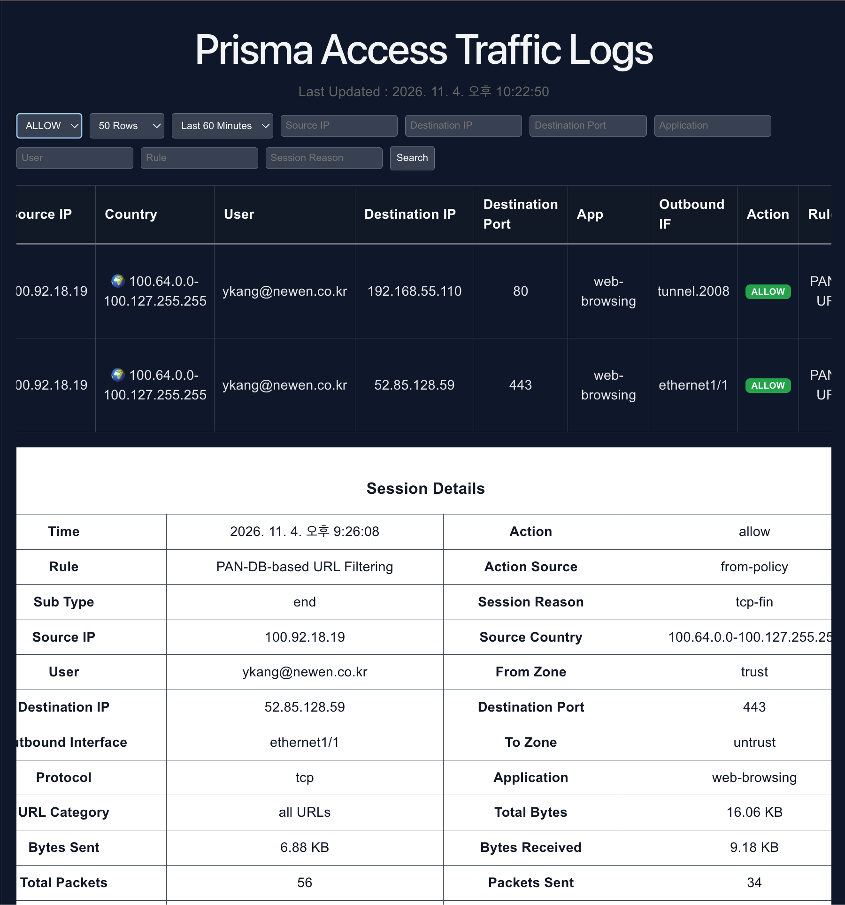
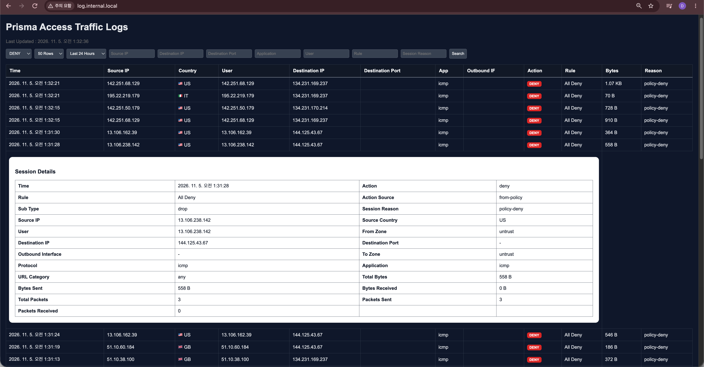

# Prisma Access Traffic Log Portal

## Dashboard




---

Prisma Access / Cortex Data Lake Traffic Log Viewer

## Features

- Traffic Log Search
- Allow / Deny Filter
- Source IP Filter
- Destination IP Filter
- User Filter
- Rule Filter
- Session Reason Filter
- Auto Refresh
- Traffic Detail Expansion
- Bytes / Packets Statistics

---

## Architecture

```text
Prisma Access
      |
      v
FastAPI Backend
      |
      v
React Frontend
```

---

## Screenshots

### Main View

- Time
- Source IP
- Destination IP
- App
- Action
- Rule
- Bytes
- Reason

### Detail View

- Protocol
- URL Category
- Zone Information
- Packets
- Bytes
- Session Details

---

## Backend

### FastAPI

Port:

```text
28000
```

Run:

```bash
uvicorn app.main:app --host 0.0.0.0 --port 28000
```

---

## Frontend

### React + Vite

Port:

```text
30000
```

Run:

```bash
npm install
npm run dev
```

---

## Docker

Start:

```bash
docker compose up -d --build
```

Stop:

```bash
docker compose down
```

Logs:

```bash
docker logs prisma-backend
docker logs prisma-frontend
```

---

## Configuration

Create:

```bash
backend/.env
```

Example:

| `CLIENT_ID` / `CLIENT_SECRET` | 서비스 계정 자격증명 | SCM → Settings → Identity & Access → Service Account 생성 |
| `TSG_ID` | Tenant Service Group ID (숫자) | SCM 테넌트 정보 |
| `LS_TENANT` | Strata Logging Service 테넌트(인스턴스) ID | Log Viewer 요청 헤더 `prisma-tenant`의 `:` 뒤쪽 값 (HAR로 확인) |
| `REGION` | Prisma Access API 리전 (예: `jp01`) | Log Viewer 요청 URL의 `pa-<region>` 부분 (HAR로 확인) |

```env
# Prisma Access Service Account

CLIENT_ID=xxxxxx@xxxxx.iam.panserviceaccount.com
CLIENT_SECRET=xxxxxxxx

# Tenant Service Group ID
TSG_ID=xxxxxxx

# Logging Service Tenant
LS_TENANT=xxxx

# Prisma Access Region
REGION=sg01

# Redis

REDIS_HOST=redis
```

---

## API

### Health

```http
GET /api/health
```

### Traffic Logs

```http
GET /api/logs/traffic
```

Parameters:

| Parameter | Description |
|------------|------------|
| action | allow / deny |
| source_ip | Source IP |
| dest_ip | Destination IP |
| user | User |
| rule | Policy Rule |
| reason | Session Reason |
| limit | Number of rows |

Example:

```http
/api/logs/traffic?action=deny&limit=50
```

---

## Future Enhancements

- CSV Export
- Destination Port Filter
- Dark Mode
- Authentication
- Panorama Integration

---

## Disclaimer

This project is intended for Prisma Access visibility and operational monitoring.


---

# Change Log

<details>
<summary>2026-11-04</summary>

### Added

- Action Filter (Allow / Deny)
- Source IP Filter
- Destination IP Filter
- Destination Port Filter
- Application Filter
- User Filter
- Rule Filter
- Session Reason Filter

### Added Log Fields

- Source Country
- Destination Port
- Outbound Interface

### Added Time Range

- Last 5 Minutes
- Last 60 Minutes
- Last 24 Hours
- Last 7 Days

### Added Session Details

- Action Source
- Sub Type
- Session Reason
- Source / Destination Zone
- URL Category
- Protocol
- Bytes Statistics
- Packet Statistics

### UI Improvements

- Expandable Session Details
- Country Flag Display
- Allow / Deny Badge
- Last Updated Timestamp
- Result Limit Selector
  - 10 Rows
  - 50 Rows
  - 100 Rows
  - 500 Rows

### Backend Improvements

- Dynamic Time Range Query
- Destination Port Filtering
- Application Filtering
- Enhanced Traffic Search
</details>

<details>
<summary>2026-11-06</summary>

- Added Traffic logs
- Added URL logs
- Added Threat logs
- Added Threat filtering
- Added Time Range selector
- Added Row limits
- Added Auto refresh

</details>

<details>
<summary>2026-11-05</summary>

- Initial project setup
- Docker Compose
- FastAPI
- React

</details>
